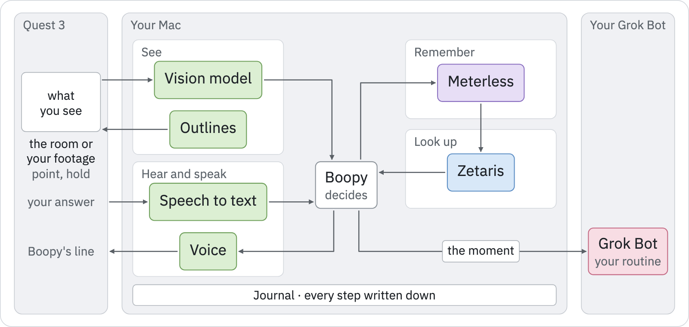

<h1 align="center">Boopy</h1>

<p align="center">
  <a href="#getting-started">Getting started</a> ·
  <a href="docs/README.md">Docs</a> ·
  <a href="docs/architecture.md">Architecture</a> ·
  <a href="#submission-checklist">Submission checklist</a>
</p>

<p align="center">
  <a href="service/package.json"></a>
  <a href="quest/README.md#requirements"></a>
  <a href="quest/README.md#requirements"></a>
</p>

Point at something through Quest 3, live or in your own footage. A local model on your Mac guesses
what it is. If you set a language to practise, Zetaris gives the word and Meterless recalls what
you practised, and if you connect it, your Grok Bot gets the moment.

<p align="center">
  
  <br><sub>Everything in the middle runs on your Mac, and every step is written to a journal.</sub>
</p>

## The problem

Personal agents now act for you: Grok Bot, Meta's Muse, OpenAI's Dots and Claude Duet. They only
know what you type or upload. What you see, in the room or in your own footage, doesn't reach them
on its own. If you saw tents at a desert camp at sunrise and want their name in Korean, you first
have to describe them or find the photo.

<sub>Sources: xAI, Grok Bot docs; Social Media Today, 9 Sep 2026; Al Jazeera, 30 Sep 2026; ITdaily, 22 Oct 2026.</sub>

## What Boopy does

<table>
  <tr>
    <td width="33%" valign="top">
      <h3>Point</h3>
      Point at something, live through Quest 3 or in your own footage, played in the headset at the size you saw it.
    </td>
    <td width="33%" valign="top">
      <h3>Boopy decides on your Mac</h3>
      A local model guesses what it is, and Boopy keeps it a guess. Zetaris finds the word, and Meterless remembers what you practised.
    </td>
    <td width="33%" valign="top">
      <h3>Your Grok Bot gets the moment</h3>
      Each boop goes to your own Grok Bot routine with a small picture of what you pointed at, so you can pick it up later on your other devices.
    </td>
  </tr>
</table>

Boopy listens for you to say the word and tells you only whether it heard it, never whether your
accent is right, because the recognizer can be wrong. Without Zetaris, Boopy gives no word and says
so. It never falls back to the model's own translation.

## Demo

Boopy on footage from a trip to the Sahara, replayed on Quest 3, with Korean as the language to
practise:

| You point at | Boopy shows and says |
| --- | --- |
| The tents | 천막, Tent. "Tent, I think. In Korean, that's 천막. Can you say it?" |
| Your answer, 천막 | "I heard 천막." |
| The tents, a second time | "Tent, I think. Last time I heard 천막. Can you say it again?" Under the word: "Heard it last time". |
| The sky | 하늘, Sky. "Sky, I think. In Korean, that's 하늘. Can you say it?" Under the word: "You tried 천막 (tent) before." |
| A person | "I don't have a Korean word for person yet." |

Each boop also sent its moment to a Grok Bot routine, and the headset showed "Sent to your Grok
Bot" once the routine's run had started. In this take the taps were sent from the Mac through the
app's development hook ([a boop from adb](quest/README.md#a-boop-from-adb)), and the spoken answer
was a synthetic voice clip (a macOS Korean voice). The footage is not in this repository.

A rehearsal on the Mac with a real photo of a camel, answered by synthetic voice clips: the model
guessed "Camel" in 17.0 s on a cold start and 3.2 s warm, and the Zetaris pick took 1.2 s and
1.6 s. After a wrong answer, the next look said "Last time 낙타 didn't come through. Want to try
again?".

## How Boopy decides

- **The model's answer is only a guess.** A local vision model (Ollama, `qwen3.6:35b-a3b-nvfp4`
  by default) proposes what you pointed at, with a confidence. It stays a proposal until you act
  on it.
- **The word comes from Zetaris.** One fixed query, `term-pick-v1`, joins the word list with your
  practice record and returns the word with a reason: new, heard before, or not heard before. The
  reason sets Boopy's line. The model never picks the word.
- **Meterless remembers what you practised and hands it to Zetaris.** It recalls earlier practice
  from the journal, by the same guess and by the same recording, and adds it to the Zetaris query.
- **Every step is logged and can be replayed.** Every change is appended to a journal, and the
  current state is rebuilt from it. `pnpm trace` prints each step without any of your words.

The trace of the tents in the demo, then of the next look at them (shortened: some ids, fields and
lines are left out):

```text
observe   obs_mvqzdan9… frame 56cd8255… (recorded footage rec_04a3…, frame rfr_b8dd…)
evidence  Boopy's guess "tent", proposed by ollama/qwen3.6:35b-a3b-nvfp4 in 6319 ms, confidence 0.9
retrieve  H-MEM over the journal's practice: 0 hit(s); recalled none; 0 task(s) left out
retrieve  Zetaris term-pick-v1 on this Mac for "tent" in ko: passed in 1325 ms; stage 392 ms, pick 388 ms
retrieve    Q170544 subject 천막 (ko), gloss tent; Wikidata revision 2559951389, CC0-1.0, external-unreviewed; practice 0 attempt(s): new
decide    term: Q170544 because new
act       revision 1, Boopy's own stand-in: "Tent, I think. In Korean, that's 천막. Can you say it?"
send      moment to your Grok Bot (attempt 0): run started
update    answer evt_0631…: recognizer whisper.cpp large-v3-turbo, recognition uncertain; the words are not printed
update    Boopy heard: heard against 천막 (term-in-recognized-text-v1, recognition uncertain)
act       revision 3, Boopy's own stand-in: "I heard 천막."
send      moment to your Grok Bot (attempt 1): run started
update    practice table in Zetaris rewritten from the journal: passed, 1 row(s) in 1021 ms

evidence  Boopy's guess "tent", proposed by ollama/qwen3.6:35b-a3b-nvfp4 in 4353 ms, confidence 0.9
retrieve  H-MEM over the journal's practice: 1 hit(s) …; recalled Q170544; 0 task(s) left out
retrieve  Zetaris term-pick-v1 on this Mac for "tent" in ko: passed in 2039 ms; practice table 1 rows
decide    term: Q170544 because heard-before
act       revision 1, Boopy's own stand-in: "Tent, I think. Last time I heard 천막. Can you say it again?"
```

## Your Grok Bot

If you set up a Grok Bot routine with a webhook trigger, each boop's moment goes to it, one way:
the guess, the word and its source, whether Boopy heard you, Boopy's spoken line when it draws on
earlier practice, and on the first moment a small picture of what you pointed at. Boopy says "Sent
to your Grok Bot" only once the Bot's run has started; the Bot's reply stays in its chat. With no
routine, or a send that failed or has not started, it says "Not sent to your AI". No transcript,
capture time or place is sent. Setup and limits are in
[the service README](service/README.md#moments-to-your-grok-bot).

## Sponsor technology

| Zetaris | Meterless | Cursor |
| --- | --- | --- |
| Finds the Korean word for what you point at, and keeps track of whether Boopy heard you say it. | Remembers what you've practised in this footage, and reminds you when you point at something else. | Boopy was built in Cursor. |

### Zetaris: Boopy's data layer

- **What it holds.** The word list Boopy can teach: 14 concepts with 268 label, alias and
  description rows in 8 languages, from a dated Wikidata snapshot (CC0, revision ids kept). And your
  practice record, staged from every counted attempt in Boopy's journal (ids, concept, language,
  result and time; no words you said). Zetaris runs locally on the Mac, in Docker, on loopback only.
- **How it decides.** One fixed, governed query, `term-pick-v1`, joins the word list with your
  practice record and returns the word to teach with a reason: new, heard before, or not heard
  before. That reason is what changes Boopy's line when you come back to the same thing: "Tent, I
  think. Last time I heard 천막. Can you say it again?", or "Last time 천막 didn't come through.
  Want to try again?". Your guess has to match a label or alias in the list, by itself, its
  singular or its head noun.
- **Access rules.** Boopy's practice account can read the word list and its own practice tables,
  and Zetaris refuses it any other table. Writes go through Boopy's fixed statements only, and every
  word row a pick returns is checked against the import's receipt, kept outside Zetaris. See
  [the Zetaris probes](service/probes/zetaris/README.md).

### Meterless: recall of earlier practice

An adopted subset of Meterless H-MEM (`service/src/memory/hmem/`, upstream `Meterless/Meterless`
at `0aa7417`, Apache-2.0, with its licence and notice beside the code) recalls your earlier practice
from the journal, by the same guess and by the same recording. It leaves out anything from a task
whose subject you marked wrong, and adds the recalled concepts to the Zetaris query. Its visible
effect: when you boop something else in footage where you practised before, the detail under the
word adds what you tried there, for example "You tried 천막 (tent) before." on the sky. The changed
line on a return visit to the same thing comes from the Zetaris practice record, not from recall.
This is not full H-MEM conformance: the reference embedder is deterministic, not semantic.

## Architecture

Boopy has two parts: the Quest 3 app and the Boopy service on your Mac. The headset talks only to
the service, holds no model keys and makes no interpretation decisions. The service listens on
loopback only, and the headset reaches it over USB.

| Part | What it does | Read more |
| --- | --- | --- |
| Quest 3 app, `quest/` | Captures what you look at and where you point, plays your own footage fixed in front of you, shows the word and the outline in the room, and plays Boopy's line | [Quest README](quest/README.md) · [Experience](docs/experience.md) · [Design](docs/design.md) · [Recorded scenes](docs/recorded.md) |
| Boopy service, `service/` | Runs on your Mac: the vision model's guess, speech to text, Boopy's voice, the journal, the calls to Zetaris and Meterless, and the moments to your Grok Bot | [Service README](service/README.md) · [Architecture](docs/architecture.md) |
| Tasks and the journal | Every change is appended to the journal, and current state is rebuilt from it. A model's output stays proposed until you act on it | [Interaction](docs/protocol.md) · [Memory](docs/evidence.md) |
| Zetaris | The word list and your practice record, in Docker on loopback; one fixed query picks the word | [Zetaris probes](service/probes/zetaris/README.md) |
| Meterless H-MEM | Recall of earlier practice from the journal | [`service/src/memory/hmem/`](service/src/memory/hmem/) |

## Getting started

### From a fresh clone, without a headset

Requires macOS with Xcode's command line tools, Git, Node.js 24.15 or newer, and pnpm 10.

```bash
git clone https://github.com/glendonC/boopy.git
cd boopy/service
pnpm install --frozen-lockfile
pnpm check
```

`pnpm check` runs the typecheck, the linter and the tests. The tests use synthetic pictures and
test doubles, so nothing reaches a model and no key is needed. Without FFmpeg, the few codec tests
skip.

To run a whole session without a headset or a model:

```bash
pnpm ocr:build
cp .env.example .env
node --env-file=.env src/main.ts
```

`ocr:build` compiles the OCR tool with Swift and makes the `.build/` folder the simulator writes
to. The `.env` example uses the fixture interpreter in place of a model, keeps its journal in
`service/.data/`, and leaves Zetaris and the Grok Bot off. Then, in a second terminal in
`service/`:

```bash
BOOPY_DATA_DIR=.data pnpm simulate
```

It drives a whole session on a synthetic picture, applies corrections, and reads the context back
over MCP.

### With Quest 3

On the Mac: Ollama with `qwen3.6:35b-a3b-nvfp4`, whisper.cpp with `large-v3-turbo`, and Xcode's
Swift compiler for the OCR tool. For the headset: Unity 6000.3.25f1 with Android Build Support,
and a Quest 3 or 3S in developer mode on a USB-C data cable. The
[service README](service/README.md#requirements) lists each requirement.

```bash
cd service
pnpm ocr:build
pnpm start
```

Then build and install the app as in the [Quest README](quest/README.md#build), which also maps
the port so the headset reaches the service over USB.

### Practise a language

Run Zetaris locally ([the Zetaris probes](service/probes/zetaris/README.md) import the word list
and set up the account), set the four `BOOPY_ZETARIS_*`/`BOOPY_PROBE_JAR` settings, then:

```bash
pnpm task goal --language ko
pnpm trace
```

### Connect your Grok Bot

Set `BOOPY_GROK_BOT_WEBHOOK_FILE` to a file you make with your routine's webhook URL and key. See
[moments to your Grok Bot](service/README.md#moments-to-your-grok-bot).

## Keys and secrets

No API keys or secrets are in this repository. Each key you use stays in a file you make on your
Mac, outside git:

- `service/.env`, copied from [`.env.example`](service/.env.example), which holds no keys. Git
  ignores `.env`.
- The Grok Bot webhook file named by `BOOPY_GROK_BOT_WEBHOOK_FILE`. The service refuses it unless
  only you can read it (mode `0600`), and never logs or journals its URL or key.
- The Zetaris credential files named by `BOOPY_ZETARIS_PRACTICE_CREDENTIAL_FILE` and
  `BOOPY_ZETARIS_REFERENCE_CREDENTIAL_FILE`.
- An optional Meta Model API key, in `MODEL_API_KEY` or in `model-api-key` in Boopy's data folder
  (`~/.boopy` by default).

Tests use synthetic values, and one public example value from the Standard Webhooks libraries'
own tests.

## Pre-existing components

The build window opened on 22 Oct 2026 at 00:00 UTC. This work came before it:

- **Boopy itself, from 3 to 21 Oct:** the Mac service (capture, journal, interpretation adapters,
  speech, OCR, connector), the Quest 3 client (passthrough capture, pinch to talk, outlines,
  console), the public docs, probes and synthetic test fixtures.
- **A Meterless H-MEM subset,** adopted on 12 Oct from `Meterless/Meterless` at `0aa7417`
  (Apache-2.0).
- **A Zetaris JDBC lookup** of three fixed Wikidata references, and their 15 Oct snapshot.
- **An optional local Nemotron embedding ranker** (15 Oct), not used in the demo.
- **Quest and speech setup** derived from Halcyonic, an earlier Quest project by the same author.
- **The demo footage,** the author's own, recorded before the window and not in this repository.

Built in the window: the recorded-scene path and clip playback in the headset; Zetaris as the data
layer (the word list imported on 25 Oct, the practice record and the `term-pick-v1` pick);
Meterless recall of earlier practice by guess and by recording; and each boop's moment sent to your
own Grok Bot.

This public repository was made from a private one, so its commit dates show when each change was
copied here, not when it was first written.

## Submission checklist

- ✅ Repository public, with a README that explains setup and usage: [Getting started](#getting-started)
- ✅ No API keys or secrets in the code: [Keys and secrets](#keys-and-secrets)
- ✅ Sponsor technology explanation and pre-existing components in this README:
  [Sponsor technology](#sponsor-technology) and [Pre-existing components](#pre-existing-components)
- ✅ Project runs from a clean setup: [From a fresh clone](#from-a-fresh-clone-without-a-headset)

## Related work

| Work | What it does |
| --- | --- |
| Google Sensible Agent (UIST 2025) | Proactive AR suggestions from context |
| Project Astra (Google DeepMind) | Camera, memory and tools on phone and glasses |
| Gkiolmas et al. (Constructionism 2012) | Learning by predicting and testing a model, compared with whiteboard teaching |
| ChatGPT, Gemini Live and Meta | Answer about what's in view, inside their own app |
| Boopy | Sends the moment to your Grok Bot, and takes the word from Zetaris instead of the model |

<sub>Sources: Google Research blog, 18 Sep 2025; DeepMind, Project Astra; Gkiolmas et al., 2012; TechCrunch, 12 Dec 2024; Google blog, 7 Apr 2025; UploadVR, 12 Dec 2023.</sub>

## Roadmap

- **Every personal agent:** Grok Bot today, then Meta's Muse, OpenAI's Dots and Claude Duet.
- **Every visual device:** one spatial interface on headsets, camera glasses and phones.
- **One memory:** everything you've pointed at and practised, kept by you and shared with the
  agent you choose.

## Documentation

| Start here | Go deeper |
| --- | --- |
| [Product](docs/product.md): what Boopy is, and what it is not | [Architecture](docs/architecture.md): headset, service, and where state lives |
| [Experience](docs/experience.md): how a session should feel | [Design](docs/design.md): type, colour and the interface parts |
| [Recorded scenes](docs/recorded.md): booping footage you recorded earlier | [Interaction](docs/protocol.md): tasks, actions and stale replies |
| [Service README](service/README.md): setup, configuration, Zetaris and the Grok Bot | [Memory](docs/evidence.md): corrections and what may be retrieved later |
| [Quest README](quest/README.md): build, install and the first session | [Activities](docs/activity-contract.md): the arrange and sequence files |

## Data and licences

The word list is Wikidata labels, aliases and descriptions under CC0, from a dated snapshot with
revision ids. The Meterless H-MEM subset is Apache-2.0, with its licence and notice beside the
code. The headset's font has its licence beside it in `quest/Assets/Boopy/Resources/Fonts/`. The
demo footage is the author's own and is not in this repository. The test fixtures are synthetic
drawings and test doubles.
